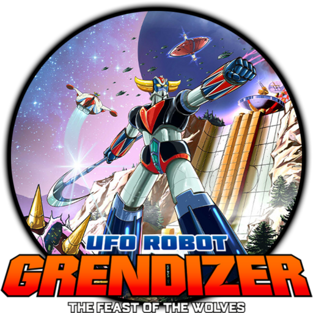
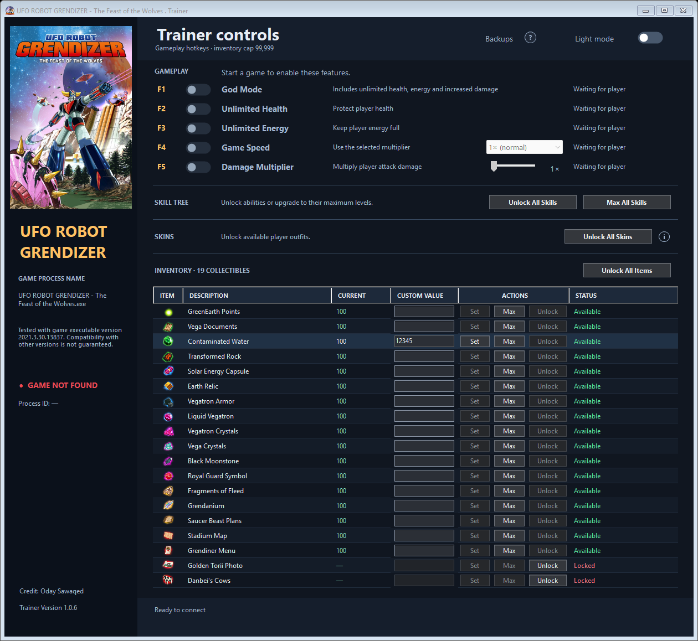
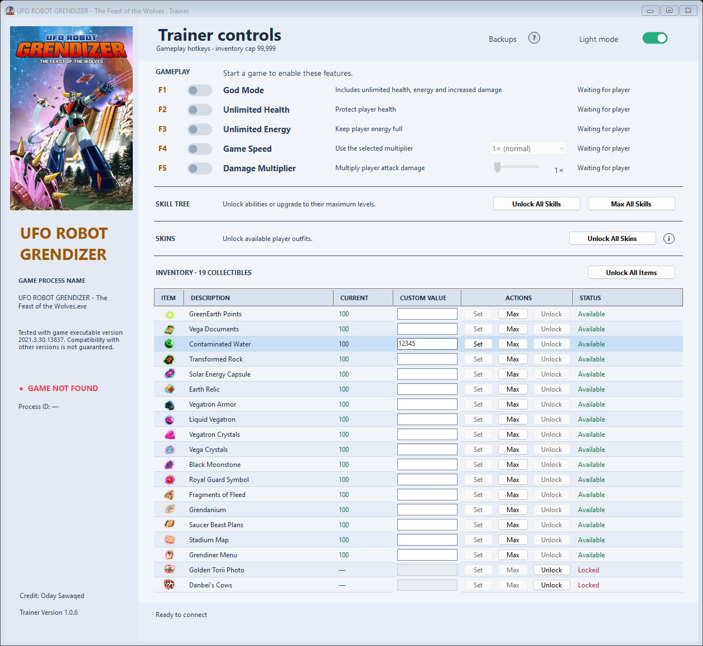
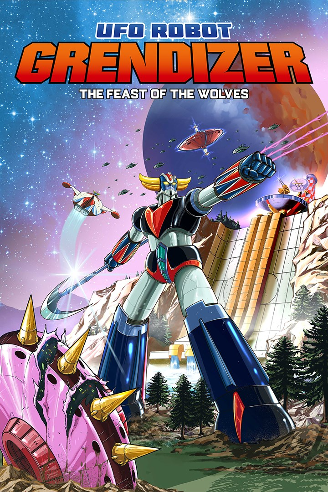

<p align="center">
  
</p>

<h1 align="center">UFO ROBOT GRENDIZER<br>The Feast of the Wolves · Trainer</h1>

<p align="center">
  <strong>Version 1.0.6 · Windows x64 · Standalone application</strong><br>
  Created by <strong>Oday Sawaqed</strong>
</p>

<p align="center">
  Gameplay controls, live inventory editing, Skill Tree upgrades, and skin unlocks<br>
  in one interface—with light and dark themes and automatic save backups.
</p>

---

## Overview

Customize your experience in **UFO ROBOT GRENDIZER – The Feast of the Wolves** with a standalone Windows trainer. The application automatically detects the running game and enables its controls after your save is loaded and a live player is located.

**Download:** Open this repository’s **Releases** page and download `GrendizerTrainer-v1.0.6.zip`.

## Screenshots

<table>
  <tr>
    <th align="center">Dark mode</th>
    <th align="center">Light mode</th>
  </tr>
  <tr>
    <td><a href="docs/images/trainer-dark.png"></a></td>
    <td><a href="docs/images/trainer-light.png"></a></td>
  </tr>
</table>

*Interface previews show sample inventory values and both available and locked items. Click an image to view it at full size.*

## Getting started

1. Download the release ZIP and extract its contents to a folder of your choice.
2. Run **`Grendizer Trainer.exe`**. Allow the Windows administrator prompt so the trainer can access the game process.
3. Start the game and load your save. The trainer detects the process automatically—there is no manual connection step.
4. Wait for **“Player located · gameplay features ready.”** Gameplay and unlock controls remain unavailable until a live player is detected.
5. Use the switches, hotkeys, and item controls described below.

The sidebar displays the game process name, process ID, and detection status. **Game found** is green; **game not found** blinks red.

## Gameplay controls

Click a switch or press its hotkey. Different sounds confirm that a feature has been switched **on** or **off**.

| Hotkey | Feature | Description |
|:---:|---|---|
| **F1** | **God Mode** | Enables the game’s built-in God Mode, including unlimited health, unlimited energy, and increased damage. |
| **F2** | **Unlimited Health** | Protects the player’s health independently of God Mode. |
| **F3** | **Unlimited Energy** | Keeps the player’s energy full independently of God Mode. |
| **F4** | **Game Speed** | Applies the multiplier selected in the dropdown: **0.5×, 0.75×, 1×, 1.5×, 2×, or 3×**. |
| **F5** | **Damage Multiplier** | Applies the slider’s selected **1×–10×** multiplier to the player’s normal attack damage path while preserving incoming damage factors. |

### How God Mode interacts with the other switches

Turning on **God Mode** turns off **Unlimited Health**, **Unlimited Energy**, and **Damage Multiplier**, then disables those controls and their hotkeys. God Mode already provides those benefits.

Turning God Mode off makes the separate controls available again, but **does not turn them back on automatically**. Game Speed remains independent.

### Player changes and pausing

- If the player dies or is replaced during respawn, gameplay options stop and the trainer searches for the live player again. Recovered options remain off until you enable them.
- Game Speed preserves the game’s paused state. If normal speed needs to be restored while paused, briefly resume gameplay to let that reset finish.
- Damage Multiplier restores the trainer-owned damage factor when disabled or during normal trainer exit. A watchdog also expires that factor if the trainer stops responding or the player changes.

*Damage Multiplier targets normal attack-reaction damage. Continuous-damage effects may use separate calculations.*

## Skill Tree

Upgrade abilities directly in the running game—no save-file editing or game restart is required.

| Button | What it does |
|---|---|
| **Unlock All Skills** | Grants the first level of each Skill Tree entry. Existing higher levels are preserved. |
| **Max All Skills** | Raises each entry to its own game-defined maximum rather than applying one arbitrary level to every skill. |

The tested build contains **12 entries**, with maximum levels of **1, 3, or 4**, depending on the skill. The trainer uses the loaded game definitions, preserves inventory quantities, and updates extra energy capacity and its HUD bars.

<details>
<summary><strong>View the Skill Tree entries</strong></summary>

- Space Thunder
- Double Harken
- Screw Crusher Punch
- Coup de Grace
- Hand Beam
- Double Harken Strike
- Shoulder Boomerang
- Antigravity Storm
- Dizer Punch
- Melee Attack
- Energy Bar — Screw Crusher Punch branch
- Energy Bar — Double Harken branch

</details>

Reopen the in-game Skill Tree to refresh its display after an upgrade. These trainer operations do not trigger achievements or force a disk save; changes persist when the game saves normally.

## Skins

**Unlock All Skins** grants missing outfit unlocks from the game’s loaded catalogue while preserving your current outfit and existing progress.

Hover over the **ⓘ** icon beside the button to see the detected outfit list. The information disappears when the pointer leaves the icon; clicking does not pin it open.

The inspected catalogue contains **Grendizer, Royal, Vega, Chrome, Classic, Retro, and Princely**. The list can vary with the game version. Edition-dependent outfits still require their existing DLC availability—the trainer does not grant DLC ownership.

Use the game’s outfit menu to choose a skin after unlocking it. The trainer does not automatically equip a different outfit or force the game to save.

## Inventory editor

Manage all **19 visible inventory items**. Each row has the item’s icon and description, its current quantity, a custom-value field, action buttons, and a color-coded status.

| Control | Behavior |
|---|---|
| **Custom Value** | Starts blank. Accepts digits only, up to **five digits**, within **0–99,999**. Input is validated as you type or paste. |
| **Set** | Writes the entered quantity to that item. Disabled while the field is blank; entering a valid number, including **0**, enables it immediately. |
| **Max** | Sets the selected item’s quantity to the trainer cap of **99,999**. |
| **Unlock** | Adds a missing item at quantity **1** and marks it discovered. Disabled when the item is already available. |
| **Unlock All Items** | Unlocks all 19 visible items, preserving existing positive quantities. New items start at **1**. |

- **Green status text** means the item is available. **Red status text** means it is locked or unavailable.
- Locked items cannot be edited until unlocked. Clicking their disabled custom-value field explains what to do.
- Hover over an item icon to view its larger thumbnail.
- Inventory items do not have hotkeys.
- **99,999 is the trainer’s editing cap**, not a claim about the game’s native maximum. Existing values above the cap are not automatically reduced.

<details>
<summary><strong>View all supported inventory items</strong></summary>

| | Item | | Item |
|:---:|---|:---:|---|
| 1 | GreenEarth Points | 11 | Black Moonstone |
| 2 | Vega Documents | 12 | Royal Guard Symbol |
| 3 | Contaminated Water | 13 | Fragments of Fleed |
| 4 | Transformed Rock | 14 | Grendanium |
| 5 | Solar Energy Capsule | 15 | Saucer Beast Plans |
| 6 | Earth Relic | 16 | Stadium Map |
| 7 | Vegatron Armor | 17 | Grendiner Menu |
| 8 | Liquid Vegatron | 18 | Golden Torii Photo |
| 9 | Vegatron Crystals | 19 | Danbei’s Cows |
| 10 | Vega Crystals | | |

</details>

Reopen the game’s inventory menu if its images or quantities have not refreshed yet.

> **Permanent unlocks:** Item unlocks, skin unlocks, and skill upgrades cannot be undone through the trainer. Once saved by the game, they remain in the save file. A confirmation warning appears once per trainer launch, shared across these operations. Restoring a previous backup also restores the progress recorded in that older save.

## Automatic save backups

### What gets backed up

Before the **first modification in each connection session**, the trainer copies the game’s existing **`.flbk` save files** and verifies those copies. This covers inventory edits, unlock operations, skill upgrades, and enabling gameplay features.

Further modifications during that connection use the same backup. A new connection creates a fresh backup before its first modification. If the backup cannot be created successfully, the requested modification is stopped.

Each backup has its own timestamped folder and a **`SHA256.txt`** verification record. Backups remain on disk until you remove them yourself.

**Backup folder — paste into File Explorer or Win + R:**

```text
%LOCALAPPDATA%\GrendizerTrainer\Backups
```

Backups contain **already-saved files from disk**. They do not capture unsaved progress in game memory, automatically save the game, or automatically restore an older save.

### How to restore a backup

1. **Close both the game and the trainer.**
2. Keep a separate copy of your current save files before replacing anything.
3. Open the backup folder above and choose the timestamped folder from before the changes you want to undo.
4. Copy **all `.flbk` files from that one backup folder** into the game’s save folder below. Replace the matching files. Do not mix files from different backups.
5. **Do not copy `SHA256.txt`** into the game’s save folder; it is only a verification record.
6. Start the game and load your save.

**Game save folder:**

```text
%USERPROFILE%\AppData\LocalLow\Microids\UFO ROBOT GRENDIZER - The Feast of the Wolves\savegames
```

**Progress made after the chosen backup will be lost.** Restoration is manual.

Click the **question-mark icon beside Backups** in the trainer for these instructions. The help window also provides **Open Backups** and **Open Save Folder** buttons. Those buttons only open folders; they do not replace any files.


## Appearance and usability

- **Light and dark modes** with a coordinated theme transition that hides intermediate mixed colors.
- Matching action buttons and clear enabled/disabled states.
- A default window size that shows every section and inventory row when the display has enough room. Smaller displays retain scrolling rather than clipping the controls.
- Built-in item thumbnails, the game artwork, and a multi-resolution application icon.
- Automatic game detection and player recovery without a manual connection button.

## Compatibility

| Requirement | Details |
|---|---|
| Operating system | Windows x64 |
| Game | UFO ROBOT GRENDIZER – The Feast of the Wolves |
| Tested executable version | **2021.3.30.13837** |
| Trainer version | **1.0.6** |
| Runtime | Self-contained; no separate .NET installation required |

Compatibility with other game versions is **not guaranteed**. Live unlock operations verify the relevant game/runtime files and refuse unsupported builds.

## Artwork and credits

<p align="center">
  
</p>

**Trainer:** Oday Sawaqed  
**Toggle audio:** Kenney Interface Sounds — CC0 / public domain.

Game names, characters, and artwork belong to their respective owners. This is an independent fan-made trainer and is not affiliated with or endorsed by the game’s rights holders.

See [Third-party notices](THIRD_PARTY_NOTICES.txt) for asset credits. No open-source license or source-code availability is implied by this binary-only distribution.

